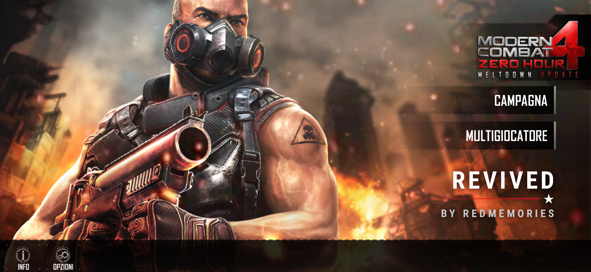
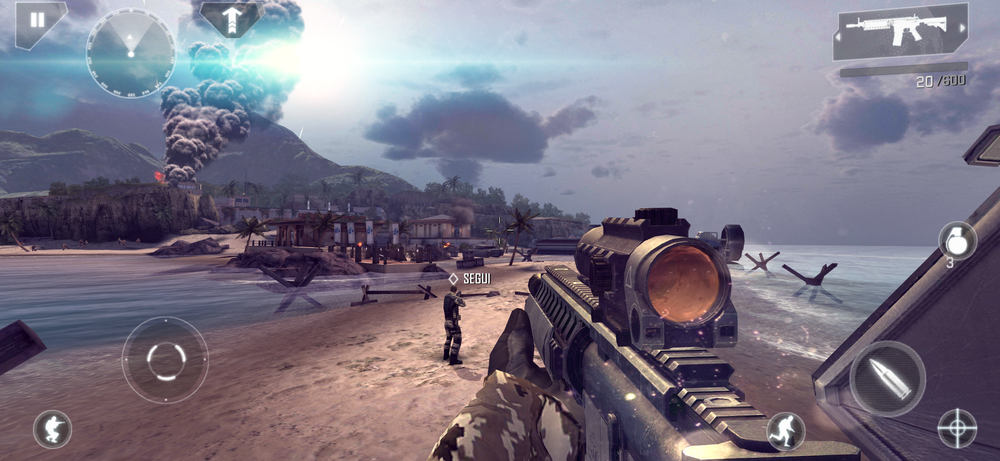
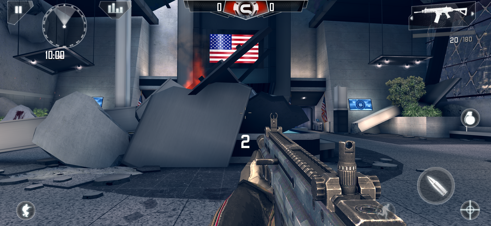

# Modern Combat 4 Revived

> Modern Combat 4: Zero Hour is a game by Gameloft. This is a non-commercial fan project, not affiliated with Gameloft. The game was pulled from the stores years ago. This repo is my private archive, please don't share the release files.

## What I did

I didn't remake the game and I didn't touch the gameplay. The campaign, the weapons, the maps and the enemies are exactly the ones from 2012.

As with The Dark Knight Rises, Iron Man 3 and Shadowgun, I recompiled the whole engine to 64-bit code ahead of time: 46,507 of its 46,513 functions, rebuilt for today's phones. The game now runs as a modern native 64-bit app.

Once it was running, I gave it the treatment it deserves on a modern phone:

- full screen on today's tall displays, edge to edge, at the full resolution of the screen: on wide screens the game used to draw the 3D scene at half resolution and stretch it
- the highest graphics profile on every GPU, with real-time shadows and depth of field, which the game always turned off on Android. GPUs the game didn't know (anything newer than 2012 that isn't an Adreno) used to get the low-end profile
- 4x anti-aliasing on the scene, the menus and the HUD, and 32-bit color instead of 16-bit
- sharper textures on surfaces seen at an angle
- a steady 60 fps, with the game speed still right
- touch controls that work on tall screens: swiping from the edges to aim no longer pauses the game with the system back gesture
- controller support in the menus and in the game, using the game's own controller mode: tested with Xbox controllers, and PlayStation or Switch controllers should work the same way, since Android maps their buttons alike

## Multiplayer

**Local Wi-Fi multiplayer works.** One phone creates the match and hosts it, the others on the same Wi-Fi network find it and join: Multiplayer → Local Wi-Fi → Play → Create custom match / Search custom matches. All the modes and maps of the game are there, and everything in Wi-Fi multiplayer is unlocked.

**Multiplayer over the internet, between players in different places, is still experimental.** I'm working on it, and I'll add it in a future version once it's stable. Until then the Online button is hidden.

## Offline, no ads

The game is fully offline for everything else, with no ads and no tracking, and it doesn't ask for any permission. Gameloft's online services don't exist anymore: the game never reaches them, and the buttons that sent you there (GLLive, the Gameloft "g", Online) are gone. The game data is packed inside the APK, so there's nothing to download separately.

The only APK I could find was the 5play "Zero Hour Mod", with infinite credits hacked in. That hack is gone: you have your real balance again, and at every launch it's topped up to 999,999 credits if it's lower.

## Install

1. Download the APK from **Releases**
2. Install it
3. Open it. The first launch takes a few seconds to unpack the game, after that it starts right away

No PC, no extra downloads, no account.

## Requirements

- 64-bit Android phone with Android 10 or newer
- about 4 GB of free space

I play it on a Galaxy S26 Ultra with Android 17. I haven't tried it on phones without a Snapdragon chip yet (MediaTek Dimensity, Exynos, Google Tensor), but I tested the game's graphics paths for those GPUs and fixed the shaders that strict drivers would reject. If you play on one of them, let me know how it runs.

## What's next

- multiplayer over the internet (see above)
- a PC version: I'm working on porting the game to PC

## Credits

Revived by **RedMemories**

Thanks to the [dynarmic](https://github.com/azahar-emu/dynarmic) project: its ARM decoder is the base of the recompiler, and it still runs the few bits of the engine that aren't recompiled.

Original game by Gameloft.

## ☕ Support my work

If you enjoy my projects and would like to support my work, you can buy me a coffee on Ko-fi! Every project I create is and will always remain free, but any support is greatly appreciated and helps me keep working on new projects and improvements.

Thank you for your support! ❤️

[ko-fi.com/redmemories_ita](https://ko-fi.com/redmemories_ita)
